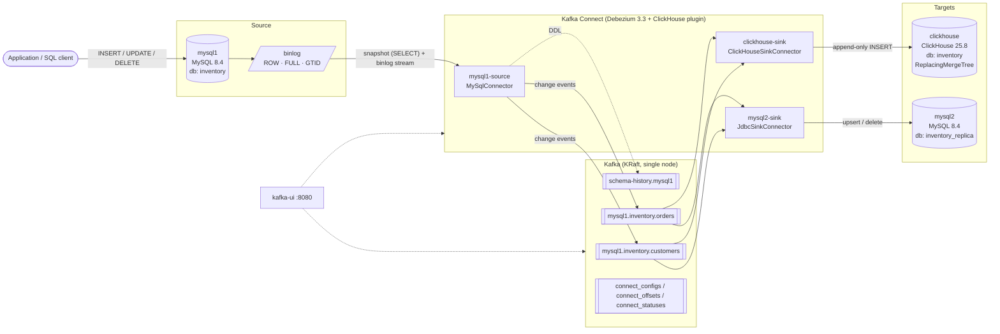
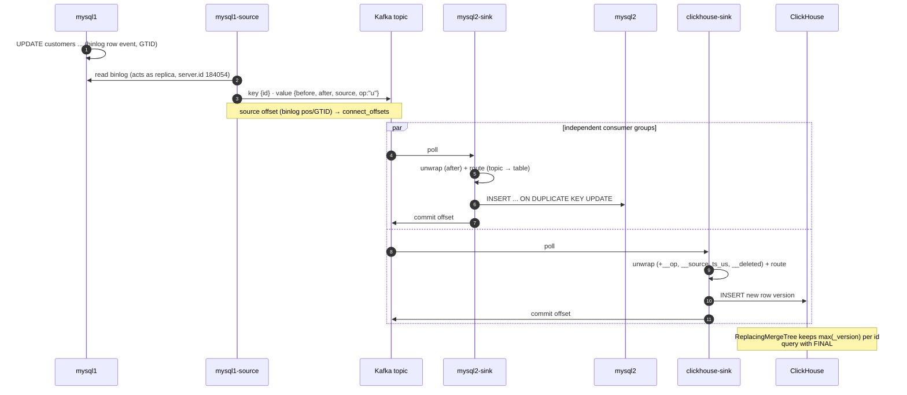

# MySQL CDC Lab — Debezium → MySQL + ClickHouse

Change Data Capture (CDC) lab: every change on `mysql1` is streamed through Debezium and Kafka and fanned out to two different targets — a MySQL replica (`mysql2`) and an analytics store (`clickhouse`).

## High-level architecture



## Event flow



## Components

| Service | Image | Port (host) | Role |
|---|---|---|---|
| `mysql1` | `mysql:8.4` | 3306 | Source. Binlog `ROW` + `FULL` row image + GTID |
| `kafka` | `apache/kafka:3.9.1` | — | Event log (KRaft, no ZooKeeper) |
| `connect` | `connect/Dockerfile` (Debezium `connect:3.3` + ClickHouse Kafka Connect `v1.7.0`) | 127.0.0.1:8083 | Runs source + both sinks |
| `mysql2` | `mysql:8.4` | 3307 | Target 1 — MySQL replica, tables auto-created by the sink |
| `clickhouse` | `clickhouse/clickhouse-server:25.8` | 127.0.0.1:8123 | Target 2 — analytics, tables from `clickhouse/init.sql` |
| `kafka-ui` | `provectuslabs/kafka-ui:v0.7.2` | 127.0.0.1:8080 | Browse topics, messages, connectors |

## Connectors

| Name | Type | Key settings |
|---|---|---|
| `mysql1-source` | `MySqlConnector` | `snapshot.mode=initial`, `topic.prefix=mysql1`, captures `inventory.customers`, `inventory.orders` |
| `mysql2-sink` | `JdbcSinkConnector` | `insert.mode=upsert`, `primary.key.mode=record_key`, `delete.enabled=true`, `schema.evolution=basic`, `unwrap` + `route` SMTs |
| `clickhouse-sink` | `ClickHouseSinkConnector` | `unwrap` with `add.fields=op,source.ts_us` and `delete.tombstone.handling.mode=rewrite`, `route` SMT |

### How each target applies a change

| Change on mysql1 | mysql2 | ClickHouse |
|---|---|---|
| snapshot / INSERT | `INSERT ... ON DUPLICATE KEY UPDATE` | new row, `__op` = `r` / `c` |
| UPDATE | same upsert | new row with higher `_version` |
| DELETE | `DELETE FROM ... WHERE id = ?` | new row with `__deleted='true'` → `is_deleted = 1` |
| ADD COLUMN | `ALTER TABLE ADD` on next event with the field | manual `ALTER TABLE` required |

ClickHouse tables use `ReplacingMergeTree(_version, is_deleted)`:
- `_version` = `__source_ts_us` (commit time on mysql1, µs) — always increases, including after the snapshot
- `is_deleted` = `__deleted = 'true'`
- `synced_at` = time the row landed in ClickHouse

Always query with `FINAL`, otherwise old versions and deleted rows show up:

```sql
SELECT * FROM inventory.customers FINAL ORDER BY id;
```

> The connector's built-in `debeziumCDCEnabled` mode is not used: for MySQL it takes `_version` from the GTID sequence number, but snapshot events have no GTID and fall back to the binlog position, so post-snapshot updates can get a *lower* version than the snapshot row and lose under `FINAL`.

## Quick start

```sh
docker-compose up -d --build

until curl -sf localhost:8083/connectors >/dev/null; do sleep 2; done

for c in mysql1-source mysql2-sink clickhouse-sink; do
  curl -s -X PUT -H 'Content-Type: application/json' \
    --data @connectors/$c.json localhost:8083/connectors/$c/config >/dev/null
done

curl -s localhost:8083/connectors?expand=status | jq -r '.[] | "\(.status.name): \(.status.connector.state)"'
```

Try it:

```sh
docker exec mysql1 mysql -uroot -proot inventory \
  -e "UPDATE customers SET last_name='Boonmee' WHERE id=2"

docker exec mysql2 mysql -uroot -proot inventory_replica \
  -e "SELECT * FROM customers WHERE id=2"

docker exec clickhouse clickhouse-client --user sink --password sink \
  -q "SELECT id, last_name, __op, _version, synced_at FROM inventory.customers FINAL WHERE id=2"
```

Reset everything: `docker-compose down -v`

Step-by-step manual walkthrough (MySQL target): [`debezium-manual-steps.md`](debezium-manual-steps.md)

## Project layout

```
.
├── docker-compose.yml
├── connect/Dockerfile            # Debezium Connect + ClickHouse sink plugin
├── connectors/
│   ├── mysql1-source.json
│   ├── mysql2-sink.json
│   └── clickhouse-sink.json
├── mysql1/init.sql               # source schema, seed data, debezium user
├── mysql2/init.sql               # sink user
├── clickhouse/init.sql           # ReplacingMergeTree target tables
└── debezium-manual-steps.md
```

## Lab vs production

This is a learning setup. Before using the pattern for real:

- **MySQL → MySQL**: prefer native MySQL replication; CDC fits when the target is a different engine or needs transformation.
- **Kafka**: ≥ 3 brokers, replication factor 3, `min.insync.replicas=2`.
- **Serialization**: Avro/Protobuf + Schema Registry instead of JSON with embedded schemas.
- **Binlog retention** longer than the longest expected connector outage; never delete or compact `schema-history.mysql1`.
- **ClickHouse**: batch inserts (`bufferCount` / `async_insert`), never per-event `ALTER TABLE ... UPDATE/DELETE`.
- **Operations**: alert on consumer lag of `connect-mysql2-sink` / `connect-clickhouse-sink`, and run periodic source-vs-target reconciliation.
